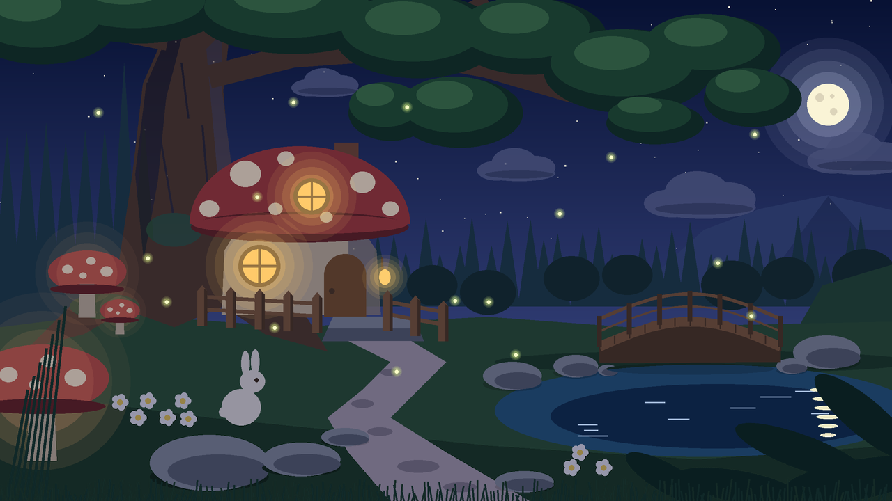

# Thế giới cổ tích 2D (Fairy Tale World)

Bài tập lớn học phần **Đồ họa máy tính (INFO3019)**, Trường Đại học CMC.
Chủ đề 4: *Xây dựng ứng dụng mô phỏng vật thể thực tế với đồ họa 2D.*

Một góc rừng cổ tích 2D, hiển thị Full HD 1920×1080: cây cổ thụ, nhà nấm, hồ nước, cầu gỗ, hoa cỏ, bướm, cá và đom đóm. Người xem có thể chuyển ngày ↔ đêm, nhấn vào vật thể để xem thông tin và thuật toán đã dùng, phóng to/thu nhỏ và kéo khung nhìn.

> **Mọi hình ảnh trong cảnh đều do thuật toán của nhóm vẽ ra từng pixel** lên `Framebuffer`. Canvas chỉ dùng `putImageData` để hiển thị. Không dùng `ctx.arc`, `ctx.fillRect`, `ctx.lineTo`, `ctx.fillText`, `ctx.drawImage`… cho thế giới.

## Định hướng hình ảnh

Ảnh dưới đây là **ảnh mẫu do AI tạo** để thống nhất bố cục, bảng màu và không khí. Đây **không phải** ảnh chụp chương trình và **không được** đưa vào chương trình. Cảnh thật sẽ được dựng lại ở mức giản lược bằng DDA, Bresenham, Midpoint, tô scanline, flood fill và biến đổi 2D.

| Ngày | Hoàng hôn | Đêm |
|---|---|---|
|  |  |  |

Bố cục chính thức (toạ độ từng vật thể): [docs/reference/layout.md](docs/reference/layout.md). Ảnh mẫu từng vật thể gắn với issue: [docs/reference](docs/reference/README.md).

| Ảnh phác bố cục (ngày) | Ảnh phác bố cục (đêm) |
|---|---|
|  |  |

Ảnh phác được dựng chỉ bằng elip, đa giác, gradient và trộn alpha, đúng những gì thuật toán của nhóm vẽ được.

## Chạy dự án

```bash
npm install
npm run dev       # chạy dev server
npm run build     # kiểm tra TypeScript + build
npm run preview   # chạy bản build
npm test          # Vitest (bổ sung ở #2)
```

## Điều khiển

| Thao tác | Chức năng |
|---|---|
| Nhấn chuột | Chọn vật thể, mở bảng thông tin |
| Rê chuột | Hiện tên vật thể |
| Cuộn chuột | Phóng to/thu nhỏ quanh con trỏ (1×–3×) |
| Kéo chuột phải/giữa, hoặc `Space` + kéo | Di chuyển khung nhìn |
| `N` | Chuyển ngày ↔ đêm |
| `+` / `-` / `0` | Phóng to / thu nhỏ / đặt lại |
| `Esc` | Bỏ chọn |

## Kiến trúc và quy ước

**Nguồn sự thật duy nhất là issue [#1 – SPEC](https://github.com/baoOyster/2D-wonderworld/issues/1)**: hợp đồng API, bố cục, layer, phân vùng file và Definition of Done. Đọc trước khi code; muốn đổi interface thì comment vào #1.

Toạ độ thế giới 1280×720; framebuffer 1920×1080 qua hằng `RENDER_SCALE` (xem #1).

```
src/
├─ core/          config, framebuffer, color, rng, raster, fill, mat3, node, font, camera, renderer, engine, input, hit-test, palette
├─ scene/
│  ├─ types.ts, layers.ts, world.ts, theme.ts
│  ├─ background/  bầu trời, sao, mặt trời/trăng, mây, núi, rừng, đất, hồ
│  ├─ midground/   cây cổ thụ, nhà nấm, hàng rào, đường đá
│  ├─ foreground/  hoa, cỏ, nấm nhỏ, bụi cây
│  ├─ lakeside/    cầu gỗ, đá, cá
│  └─ effects/     bướm, đom đóm
└─ ui/            bảng thông tin, thanh công cụ
```

## Thuật toán → ứng dụng

| Thuật toán | Ứng dụng trong cảnh |
|---|---|
| DDA | Ván cầu, gợn sóng hồ, cọng cỏ |
| Bresenham | Hàng rào, cành cây, râu bướm, đường đá |
| Midpoint đường tròn | Mặt trời/trăng, đốm nấm, nhụy hoa, đom đóm |
| Midpoint elip | Mây, tán cây, hồ, mũ nấm, thân cá, cánh bướm |
| Tô scanline | Núi, thân cây, nhà nấm, đá, mặt cầu |
| Flood fill | Hốc cây phát sáng |
| Xử lý ký tự | Font bitmap tự cài đặt, ghép dấu tiếng Việt |
| Biến đổi 2D | Mây, bướm, hoa, camera |
| Biến đổi gộp | Cây, nhà nấm, bướm, hàng rào |
| Bézier *(kiến thức mở rộng)* | Quỹ đạo bay của bướm (de Casteljau) |

Bézier không thuộc 7 chương bắt buộc của học phần; mọi chỗ dùng đều ghi rõ là kiến thức mở rộng.

## Thành viên và phân công

Issue được gán theo label `owner:tvN`. Lọc việc của mình:

```bash
gh issue list --label "owner:tv1" --state open
```

| Vai trò | Thành viên | Mảng phụ trách | Issue |
|---|---|---|---|
| TV1 | Bảo (trưởng nhóm) | Framebuffer, màu, camera/renderer/engine, tích hợp | #2 #8 #26 |
| TV2 | Quang Anh | Mat3/Node, font, input/chọn vật thể, World, panel/toolbar | #6 #7 #9 #24 #25 |
| TV3 | Hồng Phúc | Palette/ngày đêm, bầu trời, mây, núi/rừng, hồ, thỏ/chim (tuỳ chọn) | #5 #10 #11 #12 #13 #29 |
| TV4 | Nguyệt | Raster đường/tròn/elip, cây cổ thụ, nhà nấm, rào/lối đi, hoa/cỏ, nấm/bụi/lá | #3 #14 #15 #16 #17 #18 |
| TV5 | Thụ | Tô vùng, cầu, đá, cá, bướm (Bézier), đom đóm | #4 #19 #20 #21 #22 #23 |
| Cả nhóm | | Tài liệu, báo cáo, slide, QA | #1 #27 #28 |

Thứ tự mốc: **M1** nền tảng (#1–#8) → **M2** dựng cảnh tĩnh → **M3** tương tác, hiệu ứng, tài liệu, QA.

## Quy trình làm việc

1. Mỗi issue một nhánh `feat/tvN-ten-ngan`, PR vào `main`, ghi `Closes #<issue>`.
2. PR cần 1 người khác review, kèm ảnh/GIF và mô tả thuật toán đã dùng.
3. Không sửa file ngoài vùng của mình (bảng phân vùng ở #1).
4. Chạy `npm run build` và `npm test` trước khi mở PR.
5. Cập nhật `docs/algorithms.md` ngay trong PR của mình.

Kiểm tra nhanh quy tắc "không dùng API vẽ của canvas" trước khi mở PR:

```bash
grep -rnE "ctx\.(arc|ellipse|fill|fillRect|fillText|stroke|strokeText|lineTo|drawImage|bezierCurveTo)" src/scene src/ui
```

## Ghi chú về AI

Ảnh mẫu trong `docs/reference/` được tạo bằng công cụ AI tạo ảnh và chỉ dùng làm tham khảo thiết kế. Bảng màu gợi ý được đo tự động từ các ảnh này. Toàn bộ quá trình vẽ ra pixel do thuật toán của nhóm cài đặt.
