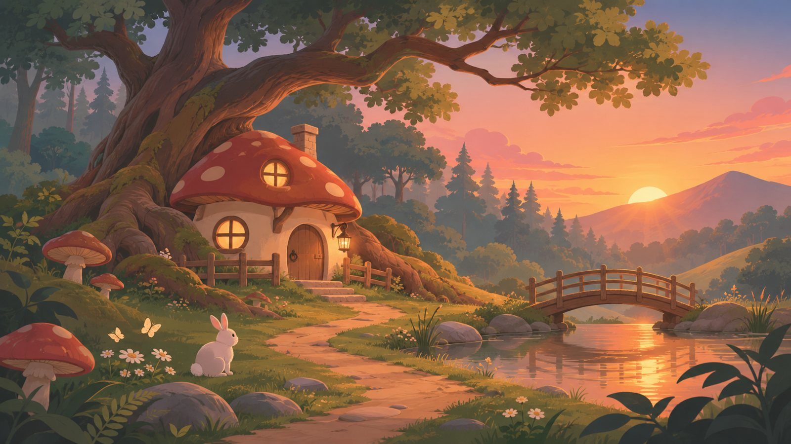
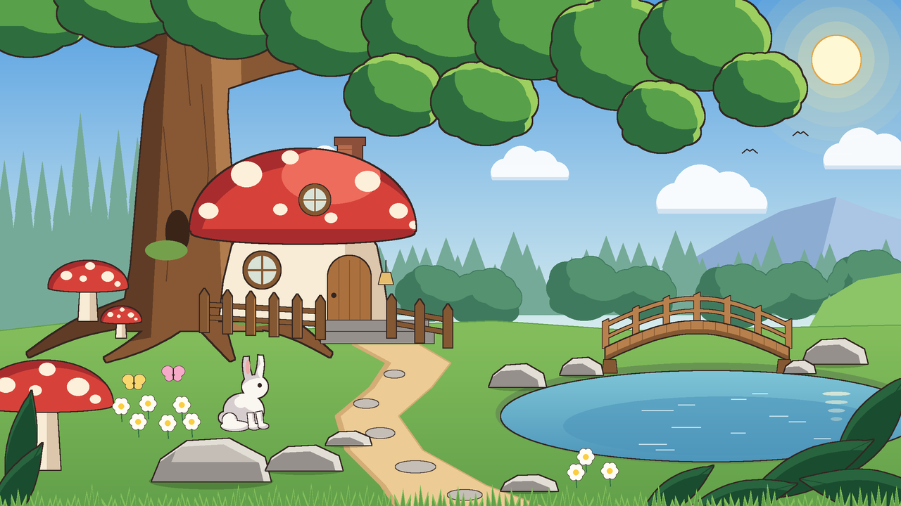

# Thế giới cổ tích 2D (Fairy Tale World)

Dự án đồ họa 2D của nhóm: dựng một cảnh cổ tích bằng các thuật toán raster tự cài đặt.

Một góc rừng cổ tích 2D, hiển thị Full HD 1920×1080: cây cổ thụ, nhà nấm, hồ nước, cầu gỗ, hoa cỏ, bướm, cá và đom đóm. Người xem có thể chuyển ngày ↔ đêm, nhấn vào vật thể để xem thông tin và thuật toán đã dùng, phóng to/thu nhỏ và kéo khung nhìn.

> **Mọi hình ảnh trong cảnh đều do thuật toán của nhóm vẽ ra từng pixel** lên `Framebuffer`. Canvas chỉ dùng `putImageData` để hiển thị. Không dùng `ctx.arc`, `ctx.fillRect`, `ctx.lineTo`, `ctx.fillText`, `ctx.drawImage`… cho thế giới.

## Định hướng hình ảnh

Ảnh dưới đây là **ảnh mẫu do AI tạo** để thống nhất bố cục, bảng màu và không khí. Đây **không phải** ảnh chụp chương trình và **không được** đưa vào chương trình. Cảnh thật sẽ được dựng lại ở mức giản lược bằng DDA, Bresenham, Midpoint, tô scanline, flood fill và biến đổi 2D.

| Ngày | Hoàng hôn | Đêm |
|---|---|---|
|  |  |  |

Bố cục chính thức (toạ độ từng vật thể): [docs/reference/layout.md](docs/reference/layout.md). Ảnh mẫu từng vật thể gắn với issue: [docs/reference](docs/reference/README.md).

| Ảnh phác bố cục (ngày) | Ảnh phác bố cục (đêm) |
|---|---|
|  |  |

Ảnh phác được dựng chỉ bằng elip, đa giác, gradient và trộn alpha, đúng những gì thuật toán của nhóm vẽ được. Phong cách vẽ (gộp khối, tô 3 tông, **viền bắt buộc cho vật thể tương tác**): [docs/style-guide.md](docs/style-guide.md).

## Chạy dự án

```bash
npm install
npm run dev       # chạy dev server
npm run build     # kiểm tra TypeScript + build
npm run preview   # chạy bản build
npm test          # Vitest (bổ sung ở #2)
```

### Trang demo

`npm run dev` rồi mở `http://localhost:5173/?demo=<tên>`. Không cần file hay trang nào khác: mọi demo chạy qua `index.html` mặc định.

| URL | Nội dung |
|---|---|
| `/?demo=scene` | **toàn cảnh**: mọi vật thể đã merge, ngày ↔ đêm tự đổi mỗi 8 giây; phím `N` đổi tay; bấm vào vật để thử tương tác (ví dụ nhà nấm mở cửa) |
| `/?demo=scene&phase=day` · `&phase=night` | toàn cảnh, đứng yên ban ngày hoặc ban đêm (tiện chụp ảnh) |
| `/?demo=midground` | cây cổ thụ, nhà nấm, hàng rào, lối đi, hoa cỏ (#14–#17) |
| `/` | demo mặc định `gradient`: nền gradient vẽ từng pixel + ô vuông nhấp nháy |
| `/?demo=primitives` | lưới toạ độ, đường/tròn/elip/đa giác, chữ, tán cây `mask()` + `shape()`, camera 1× và 2× cạnh nhau (#34) |
| `/?demo=rocks` | đá ven hồ, sỏi, lau sậy trên nền hồ tạm; rê chuột qua cụm sậy để thấy sậy ngả theo con trỏ rồi lay tắt dần (#20) |
| `/?demo=raster` | DDA so với Bresenham, nét dày, Midpoint tròn/elip (#3) |
| `/?demo=fill` | tô scanline, đa giác tự cắt, flood fill, viền mask (#4) |
| thêm `&debug=1` | chồng thêm FPS, mức zoom và thời gian vẽ mỗi khung |

Canvas giữ backing store `FB_W × FB_H` (1920×1080) và CSS letterbox đúng 16:9.

**Thêm demo cho vật thể của mình:** tạo `src/demo/<tên>.ts` export default
`(fb: Framebuffer, t: number) => void`; `src/demo/index.ts` tự nạp mọi file
trong `src/demo/`, không cần sửa `index.ts`. Mọi file demo được nạp ngay khi trang
mở, nên một file demo lỗi lúc nạp sẽ làm hỏng mọi trang demo: mở thử vài trang khác trước khi push.

**Đưa vật thể vào toàn cảnh:** `?demo=scene` tự gọi mọi hàm `create…()` trong
`src/scene/<vùng>/index.ts` (`createMidground`, `createRocks`…). Vật thể chỉ cần
có mặt trong hàm `create…()` của vùng mình là tự hiện trong toàn cảnh.

## Điều khiển

| Thao tác | Chức năng |
|---|---|
| Nhấn chuột | Chọn vật thể, mở bảng thông tin |
| Rê chuột | Hiện tên vật thể |
| Cuộn chuột | Phóng to/thu nhỏ quanh con trỏ (1×–3×) |
| Kéo chuột phải/giữa, hoặc `Space` + kéo | Di chuyển khung nhìn |
| `N` | Chuyển ngày ↔ đêm |
| `+` / `-` / `0` | Phóng to / thu nhỏ / đặt lại |
| `Esc` | Bỏ chọn |

## Kiến trúc và quy ước

**Nguồn sự thật duy nhất là issue [#1 – SPEC](https://github.com/baoOyster/2D-wonderworld/issues/1)**: hợp đồng API, bố cục, layer, phân vùng file và Definition of Done. Đọc trước khi code; muốn đổi interface thì comment vào #1.

Toạ độ thế giới 1280×720; framebuffer 1920×1080 qua hằng `RENDER_SCALE` (xem #1).

```
src/
├─ core/          config, framebuffer, color, rng, raster, fill, mat3, node, font, camera, renderer, engine, input, hit-test, palette
├─ scene/
│  ├─ types.ts, layers.ts, world.ts, theme.ts
│  ├─ background/  bầu trời, sao, mặt trời/trăng, mây, núi, rừng, đất, hồ
│  ├─ midground/   cây cổ thụ, nhà nấm, hàng rào, đường đá
│  ├─ foreground/  hoa, cỏ, nấm nhỏ, bụi cây
│  ├─ rocks/       đá ven hồ, sỏi, lau sậy
│  ├─ lakeside/    cầu gỗ, cá
│  └─ effects/     bướm, đom đóm
└─ ui/            bảng thông tin, thanh công cụ
```

## Thuật toán → ứng dụng

| Thuật toán | Ứng dụng trong cảnh |
|---|---|
| DDA | Ván cầu, gợn sóng hồ, cọng cỏ, thân lau sậy |
| Bresenham | Hàng rào, cành cây, râu bướm, đường đá |
| Midpoint đường tròn | Mặt trời/trăng, đốm nấm, nhụy hoa, đom đóm |
| Midpoint elip | Mây, tán cây, hồ, mũ nấm, thân cá, cánh bướm, sỏi, bông sậy |
| Tô scanline | Núi, thân cây, nhà nấm, đá (thân và mặt), mặt cầu |
| Flood fill | Hốc cây phát sáng |
| Xử lý ký tự | Font bitmap tự cài đặt, ghép dấu tiếng Việt |
| Biến đổi 2D | Mây, bướm, hoa, camera |
| Biến đổi gộp | Cây, nhà nấm, bướm, hàng rào, lau sậy (quay quanh gốc) |
| Bézier *(kiến thức mở rộng)* | Quỹ đạo bay của bướm (de Casteljau) |

Bézier là phần mở rộng, chỉ dùng cho quỹ đạo bay của bướm.

## Thành viên và phân công

Mỗi người có một label `owner:<tên>`, tự gán issue cho mình khi bắt đầu làm. Lọc việc của mình:

```bash
gh issue list --label "owner:nguyet" --state open
```

| Thành viên | Label | Mảng phụ trách | Issue |
|---|---|---|---|
| Bảo (trưởng nhóm) | `owner:bao` | Framebuffer, màu, presenter, camera, engine, renderer, đá ven hồ, tích hợp | #2 #32 #8 #34 #20 #26 |
| Quang Anh | `owner:quang-anh` | Mat3/Node, font, scene types, input/chọn vật thể, World, panel | #6 #7 #33 #9 #24 #25 |
| Hồng Phúc | `owner:hong-phuc` | Palette/ngày đêm, trời, mây, núi/rừng, hồ, nấm/bụi/lá tiền cảnh, thỏ/chim (tuỳ chọn) | #5 #10 #11 #12 #13 #18 #29 |
| Nguyệt | `owner:nguyet` | Raster đường/tròn/elip, cây cổ thụ, nhà nấm, hàng rào/lối đi, hoa/cỏ | #3 #14 #15 #16 #17 |
| Thụ | `owner:thu` | Tô vùng, mask/viền, cầu, cá, bướm (Bézier), đom đóm | #4 #19 #21 #22 #23 |
| Cả nhóm | `owner:all` | SPEC, tài liệu, QA | #1 #27 #28 |

Thứ tự làm và phụ thuộc: xem [issue #1](https://github.com/baoOyster/2D-wonderworld/issues/1) và dòng **Bắt đầu được khi / Merge được khi** trong từng issue.

## Quy trình làm việc

1. Nhánh đặt theo nội dung, không ghi tên người: `feat/<ten-ngan>`. PR vào `main`; issue có chia phần thì PR phần A ghi `Refs #<issue>`, PR cuối ghi `Closes #<issue>`.
2. PR cần 1 người khác review, kèm ảnh/GIF và mô tả thuật toán đã dùng.
3. Không sửa file ngoài vùng của mình (bảng phân vùng ở #1).
4. Chạy `npm run build` và `npm test` trước khi mở PR.
5. Cập nhật `docs/algorithms.md` ngay trong PR của mình.

Kiểm tra nhanh quy tắc "không dùng API vẽ của canvas" trước khi mở PR:

```bash
grep -rnE "ctx\.(arc|ellipse|fill|fillRect|fillText|stroke|strokeText|lineTo|drawImage|bezierCurveTo)" src/scene src/ui
```

## Ghi chú về AI

Ảnh mẫu trong `docs/reference/` được tạo bằng công cụ AI tạo ảnh và chỉ dùng làm tham khảo thiết kế. Bảng màu gợi ý được đo tự động từ các ảnh này. Toàn bộ quá trình vẽ ra pixel do thuật toán của nhóm cài đặt.
