# Ảnh tham khảo và bảng màu gợi ý

Thư mục này chỉ chứa **tư liệu thiết kế**. Ảnh do AI tạo, dùng để xem bố cục, tỉ lệ, cách tách bộ phận và lấy màu. **Không import ảnh này vào `src/`** và không vẽ chúng lên canvas.

Bố cục và toạ độ chính thức nằm trong [SPEC #1](https://github.com/baoOyster/2D-wonderworld/issues/1). Từ 20/11, SPEC dùng bố cục của ảnh mẫu (bảng toạ độ: [layout.md](layout.md)). Ảnh mẫu dùng để tham khảo hình dáng và màu; khi chi tiết khác SPEC thì **làm theo SPEC**.

## Ảnh phác bố cục

Dựng lại bố cục ảnh mẫu chỉ bằng elip, đa giác, gradient và trộn alpha trên khung 1280×720 (script `tools/scene_sketch.py`). Bảng toạ độ: [layout.md](layout.md).

| Ngày | Đêm |
|---|---|
| 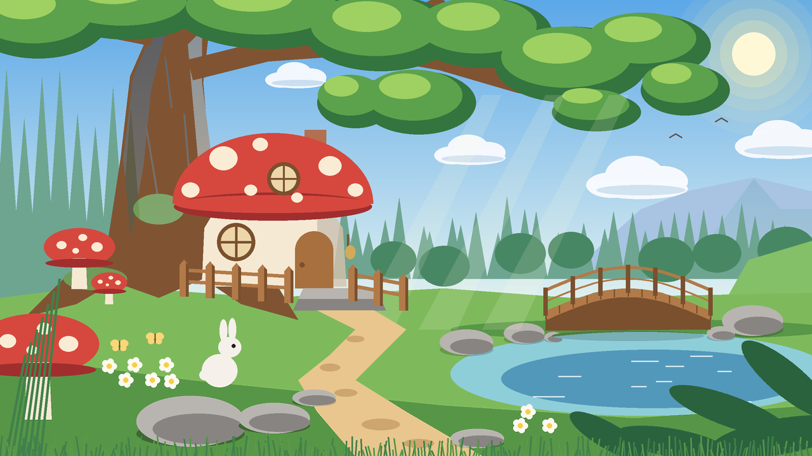 | 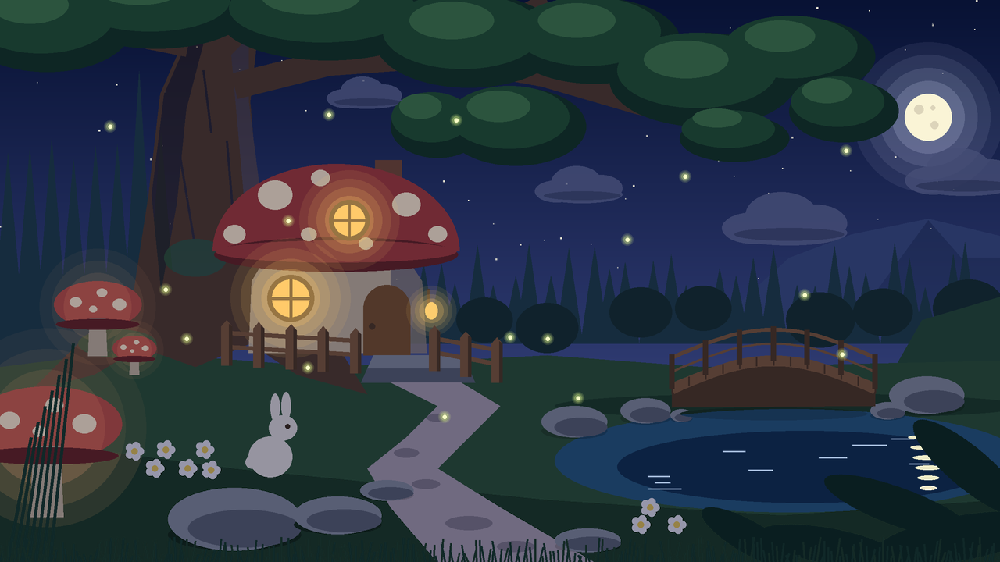 |

## Toàn cảnh (ảnh mẫu bản 1)

| Ngày | Hoàng hôn | Đêm |
|---|---|---|
|  | 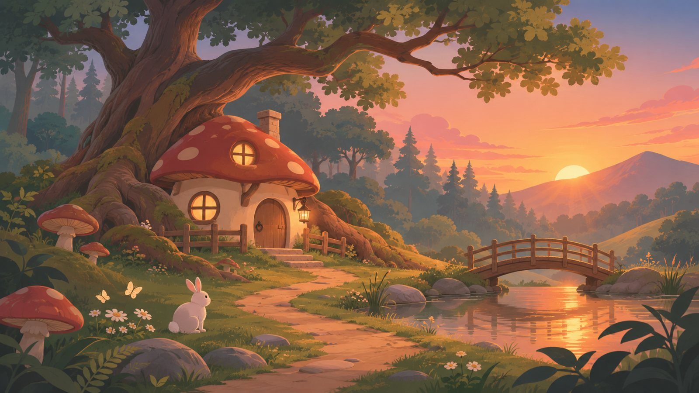 |  |

Ba ảnh có cùng bố cục, chỉ khác ánh sáng và màu. Mỗi ảnh đúng một thời điểm: tia nắng chỉ có ban ngày và hoàng hôn; trăng, sao, đom đóm, cửa sổ sáng chỉ có ban đêm.

## Từng vật thể

| Ảnh | Nội dung | Issue | Người dùng |
|---|---|---|---|
| 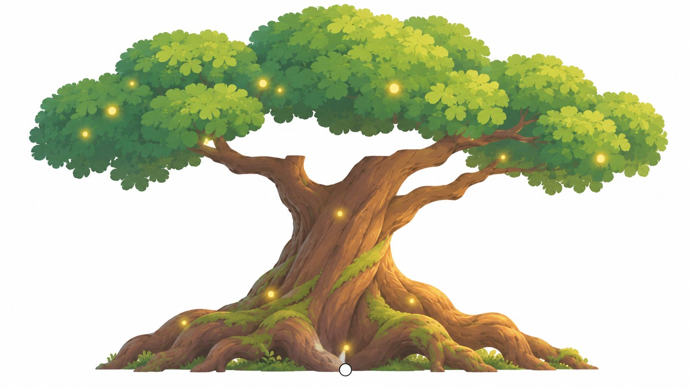 | Cây cổ thụ: thân, rễ, tán tách lớp | #14 | TV4 |
|  | Nhà nấm: mũ, đốm, thân, cửa, cửa sổ | #15 | TV4 |
|  | Hàng rào (cọc + 2 thanh ngang) và cầu gỗ vòm | #16, #19 | TV4, TV5 |
| 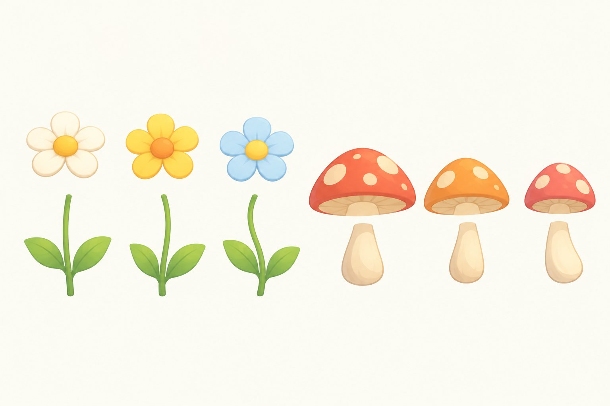 | Hoa (đầu hoa tách khỏi thân), nấm lớn/nhỏ | #17, #18 | TV4 |
| 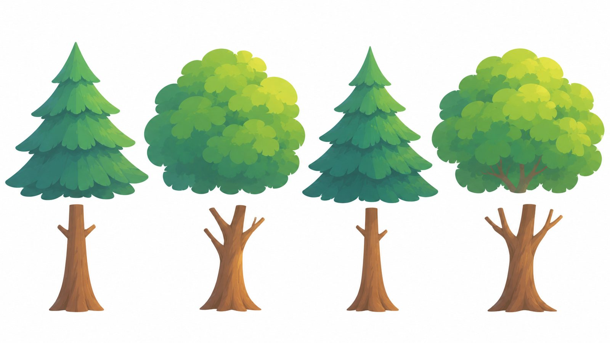 | Cây thông và cây tán tròn (cho rừng nền) | #12 | TV3 |
| 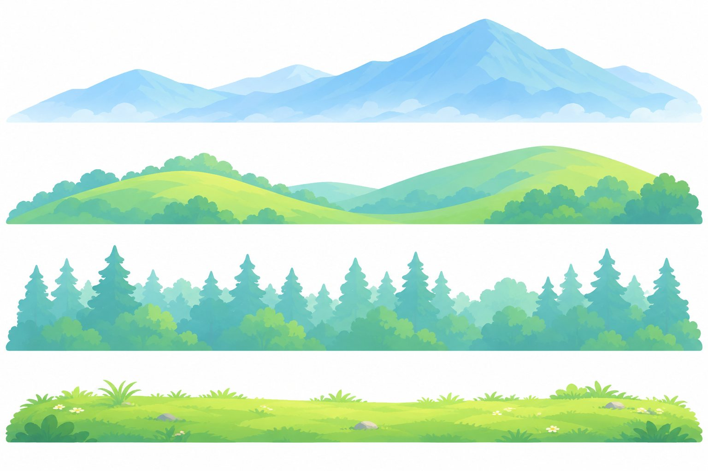 | Lớp nền: núi xa, đồi, dải rừng, mặt đất | #12 | TV3 |
| 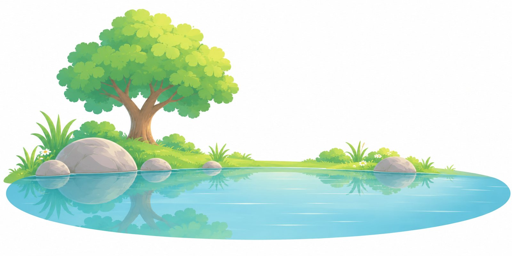 | Hồ elip, phản chiếu, đá ven bờ | #13, #20 | TV3, TV5 |
| 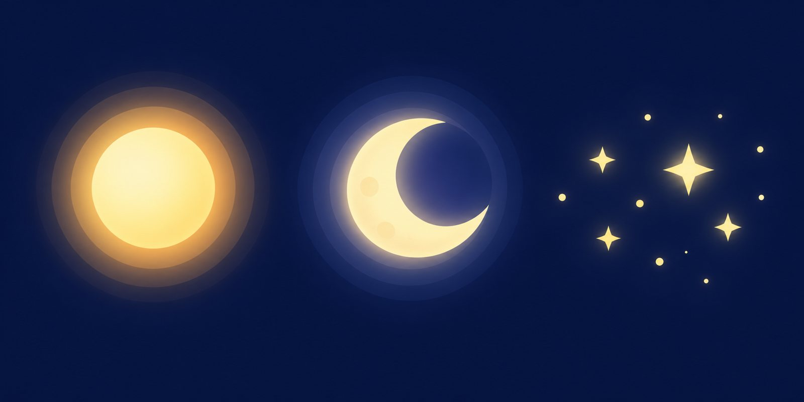 | Mặt trời, trăng khuyết, sao; quầng sáng là các vòng tròn đồng tâm | #10 | TV3 |
|  | Mây từ nhiều elip chồng nhau | #11 | TV3 |
| 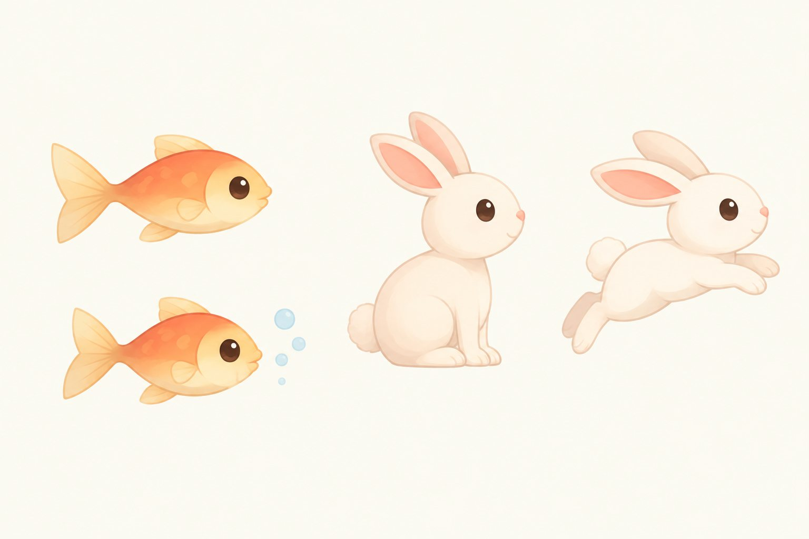 | Cá (thân elip, đuôi tam giác) và thỏ | #21, #29 | TV5, TV3 |
| 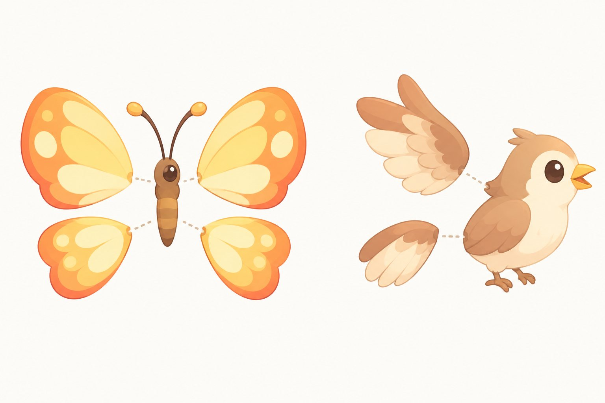 | Bướm và chim tách cánh, có đánh dấu điểm gắn cánh (tâm quay) | #22, #29 | TV5, TV3 |
|  | Đom đóm: lõi sáng + vòng glow alpha giảm dần (bỏ đèn trời) | #23 | TV5 |
| 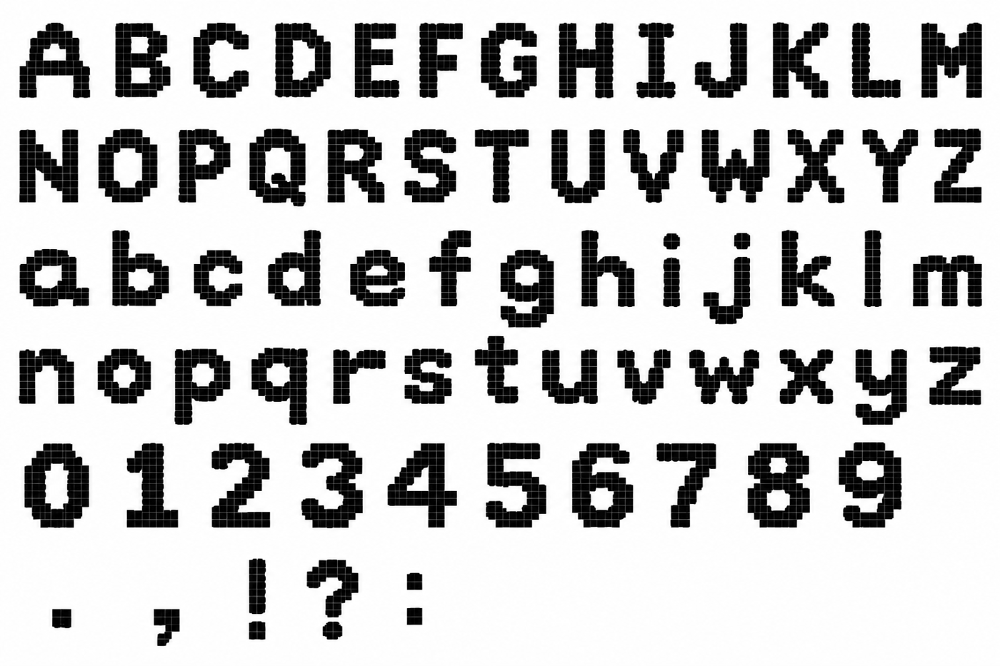 | Mẫu font pixel | #7 | TV2 |
| 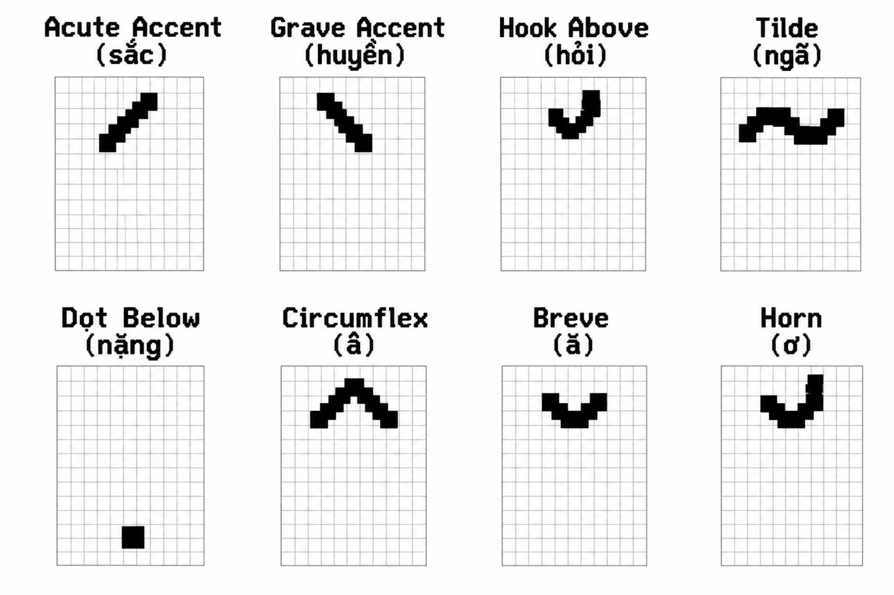 | 8 dấu tiếng Việt trên lưới pixel | #7 | TV2 |
| 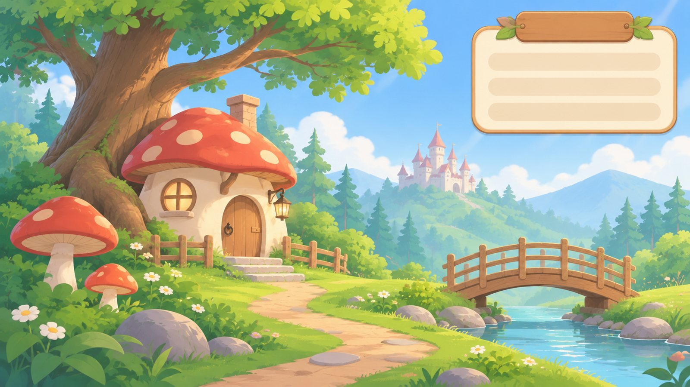 | Kiểu khung thông tin (chỉ lấy khung, bỏ phần cảnh) | #24 | TV2 |
|  | Dây leo quấn cọc (chưa có issue, để dành nếu còn thời gian) | – | – |

**Lưu ý khi dựng:** ảnh AI chi tiết hơn nhiều so với mức dựng bằng thuật toán. Hãy giản lược: tán cây = khoảng 10 elip với 2–3 tông màu; thân = đa giác + vài đường vân; bỏ dương xỉ, rêu li ti; ánh sáng (quầng sáng, tia nắng) dùng hình trong suốt trộn alpha.

## Bảng màu gợi ý

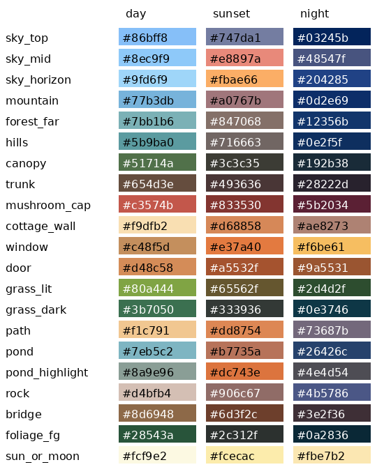

`palette.json` chứa màu đo tự động tại cùng vị trí trên ba ảnh (`day`, `sunset`, `night`). Đây là **gợi ý ban đầu cho #5**; TV3 quyết định giá trị cuối cùng trong `src/core/palette.ts`. Ánh xạ sang key của SPEC:

| `palette.json` | Key trong SPEC |
|---|---|
| `sky_top`, `sky_mid`, `sky_horizon` | `skyTop`, `skyMid`, `skyBottom` |
| `sun_or_moon` | `sun` (ngày), `moon` (đêm) |
| `mountain` | `mountainFar` |
| `forest_far`, `hills` | `forestFar`, `forestNear` |
| `canopy` | `canopy` |
| `trunk` | `trunk` |
| `mushroom_cap`, `cottage_wall` | `mushroomCap`, `mushroomStem` |
| `window`, `door` | `window`/`windowGlow`, `door` |
| `grass_lit`, `grass_dark` | `ground`, `groundDark` |
| `path`, `rock` | `pathStone`, `stone` |
| `pond`, `pond_highlight` | `waterShallow`, `waterHighlight` |
| `bridge` | `wood` |
| `foliage_fg` | `canopyDark` |

SPEC hiện chỉ có hai bảng `DAY`/`NIGHT`. Cột `sunset` dùng được nếu nhóm muốn thêm giai đoạn hoàng hôn (nội suy `DAY → SUNSET → NIGHT`).

## Prompt

`prompts_anh_mau.md` (bản 3) là prompt dùng kèm ảnh phác bố cục, theo bố cục ảnh mẫu. Khi tạo lại, lưu đè đúng tên file trong `images/` để không phải sửa README.
