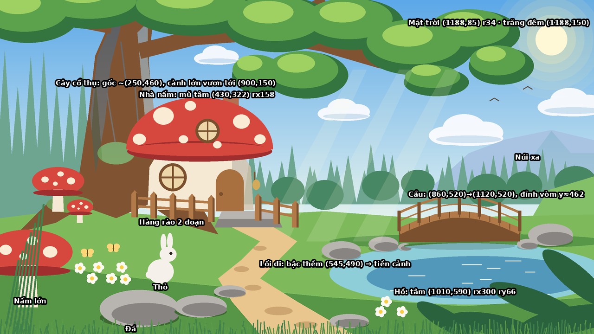
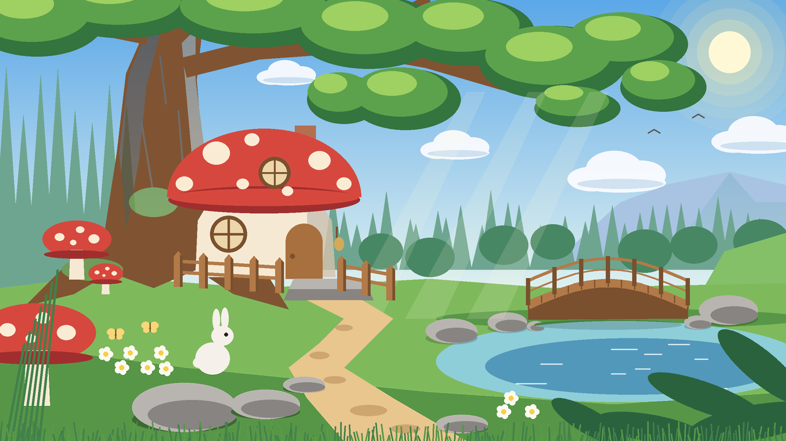

# Bố cục cảnh (đã chốt 20/11)

Bố cục lấy theo ảnh mẫu (cây lệch trái, nhà nấm nép trong rễ, lối đi lên bậc thềm, hồ và cầu bên phải). Bảng toạ độ dưới đây đã được đưa vào SPEC #1; khi có khác biệt, **SPEC #1 là chuẩn**.

Ảnh phác `layout/layout_day.png`, `layout/layout_night.png` dựng lại bố cục này **chỉ bằng elip, đa giác, gradient và trộn alpha** trên khung 1280×720, tức là đúng những thứ các thuật toán của nhóm vẽ được. Script: `tools/scene_sketch.py`.

| Có chú thích | Ngày | Đêm |
|---|---|---|
|  |  |  |

## Độ phân giải

Hiển thị **Full HD 1920×1080** nhưng **giữ toạ độ thế giới 1280×720**: framebuffer 1920×1080, camera nhân thêm hệ số `RENDER_SCALE = 1.5`. Mọi toạ độ trong bảng dưới và trong các issue giữ nguyên. Chi tiết ở phần cuối file.

## Bảng toạ độ (toạ độ thế giới 1280×720)

| Vùng | Toạ độ | Issue |
|---|---|---|
| Mép trên mặt đất | gợn quanh `y ≈ 450…470` | #12 |
| Mặt trời (ngày) | tâm `(1188, 85)`, `r = 34` | #10 |
| Mặt trăng (đêm) | tâm `(1188, 150)`, `r = 30`, ngay trên hồ nên bóng trăng trên mặt hồ hợp lý | #10, #13 |
| Núi xa | đỉnh `(1188, 282)`, chân `x = 900…1280`, đế `y = 430` | #12 |
| Rừng silhouette | dải trái `x = 0…230` (thông cao, đỉnh `y ≈ 90…210`); dải giữa–phải `x = 540…1280`, đỉnh `y ≈ 310…370`, đế `y = 440`; đồi phải `x = 1140…1280`, `y = 380…480` | #12 |
| Cây cổ thụ | rễ `x = 40…470`, `y = 380…505`; thân `x ≈ 190…360` từ `y = 40` tới `440`; cành lớn `(300,110) → (560,70) → (900,148)`; tán = 11 cụm elip dọc mép trên `x = 0…1120`, `y = 0…200`; điểm xoay tán `(300, 110)`; hốc cây phát sáng trên thân quanh `(250, 330)` | #14 |
| Nhà nấm | mũ vòm tâm `(430, 322)`, `rx = 158`, `ry = 112` (nửa trên); thân `x = 318…546`, `y = 330…452`; cửa sổ tròn `(372, 382)` `r = 24`; cửa sổ trên mũ `(447, 282)` `r = 20`; cửa vòm `x = 465…525`, `y = 365…455`; ống khói `x = 480…514`, `y = 205…250`; đèn treo `(552, 398)`; bậc thềm `x = 462…608`, `y = 455…490`. Nhà nằm **trước** rễ cây (layer HOUSE > TREE) | #15 |
| Hàng rào | 2 đoạn: trái `x = 290…455`, `y = 418…478`; phải `x = 556…636`, `y = 425…490` | #16 |
| Lối đi | đất có vài phiến đá phẳng, từ bậc thềm `x = 500…590, y = 490` uốn xuống `x = 560…760, y = 720`, rộng dần | #16 |
| Hồ nước | tâm `(1010, 590)`, `rx = 300`, `ry = 66`; góc phải dưới bị lá tiền cảnh che | #13 |
| Cầu gỗ | chân `(860, 520) → (1120, 520)`, đỉnh vòm `y ≈ 462`, lan can cao 40; nằm phía sau hồ | #19 |
| Đá | ven hồ `(735,540)`, `(826,526)`, `(1186,506)`, `(1136,526)`; tiền cảnh `(300,665)`, `(432,660)`, `(495,628)`, `(752,692)` | #20 |
| Cá | quỹ đạo elip tâm `(1010, 600)`, `rx ≈ 220`, `ry ≈ 36` | #21 |
| Nấm lớn | `(125, 408)`, `(172, 456)`, tiền cảnh `(60, 572)` | #18 |
| Hoa | cụm trái `x = 165…275`, `y = 570…605`; cụm phải `x = 815…870`, `y = 645…675` | #17 |
| Bướm | quanh cụm hoa trái `(190…250, 530…550)` | #22 |
| Đom đóm | quanh tán cây, nhà nấm và lối đi | #23 |
| Lá to tiền cảnh | góc phải dưới `x = 900…1280`, `y = 560…720` | #18 |
| Thỏ *(tuỳ chọn, #29)* | ngồi cạnh lối đi `(346, 585)`; nhấn để nhảy | – |
| Chim *(tuỳ chọn, #29)* | 2 con ban ngày quanh `(1065,215)`, `(1137,190)` | – |

## Thay đổi so với SPEC ban đầu

- Cây cổ thụ lệch trái, thân hơi xoắn, một cành dài vươn hết mép trên; tán đung đưa quanh điểm gắn cành.
- Nhà nấm nép trong rễ cây, có ống khói và đèn treo.
- Mặt trăng cùng góc phải với mặt trời, ngay trên hồ.
- Hàng rào 2 đoạn hai bên cửa; lối đi đất từ bậc thềm xuống tiền cảnh.
- Thêm lá to tiền cảnh (#18), thỏ và chim (tuỳ chọn, #29).
- Hiển thị Full HD, toạ độ thế giới giữ 1280×720.

## Chi tiết Full HD

- `Framebuffer` 1920×1080; `Camera.matrix() = scale(RENDER_SCALE) · translate(pan) · scale(zoom)`, với `RENDER_SCALE = FB_WIDTH / 1280`. Object vẫn vẽ ở toạ độ 1280×720, `screenToWorld` chia lại nên hit-test không đổi.
- Bán kính, độ dày nét nhân theo `RENDER_SCALE · zoom` (renderer đã làm việc này cho `zoom`).
- Overlay (chữ, viền chọn) dùng `scale(RENDER_SCALE)`; font 6×10 vẽ ở scale ≥ 2 để đọc được.
- CSS: bỏ `image-rendering: pixelated`, dùng mặc định cho mượt.
- Hiệu năng: số pixel gấp 2,25 lần. **Cache lớp tĩnh** (trời, núi, rừng, đất) là bắt buộc, không còn là tuỳ chọn ở #26; vẽ lại cache khi palette đổi hoặc khi zoom/pan.
- Để `RENDER_SCALE` là hằng số: máy yếu đặt 1 (1280×720), màn hình lớn thử 2 (2560×1440).
