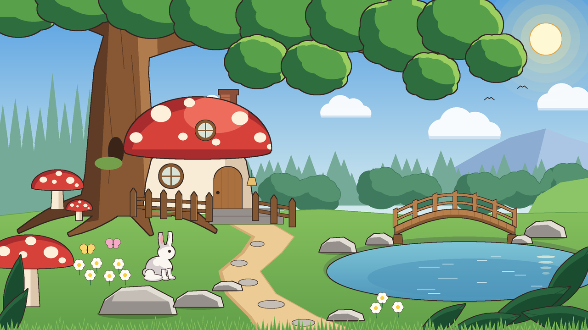

# Hướng dẫn phong cách vẽ

Mục tiêu: cảnh trông như **tranh truyện**, mỗi vật đọc ra thành một khối rõ ràng, không phải các hình chồng lộn xộn. Mọi quy tắc dưới đây đều làm bằng thuật toán tự cài đặt của nhóm.

| Ngày | Đêm |
|---|---|
|  |  |

## 4 quy tắc

### 1. Gộp khối rồi mới tô
Vật thể ghép từ nhiều hình (tán lá = nhiều elip, thỏ = thân + đầu + tai) phải được **vẽ vào một `Mask` trước**, rồi tô cả vùng một lần. Không tô từng elip riêng, nếu không sẽ lộ mép giữa các hình.

```ts
const m = r.mask();                 // Mask theo toạ độ world (#8)
m.ellipse(470, 30, 86, 70); m.ellipse(520, 10, 40, 40); /* ... */
r.shape(m, { fill: p.canopy, shade: p.canopyDark, highlight: p.canopyLight, outline: p.ink });
```

### 2. Tô 3 tông theo một hướng sáng chung
Nguồn sáng ở **trên-phải** cho cả cảnh (mặt trời / trăng nằm ở góc trên phải).
- **Tối**: phần của vùng không bị che khi dịch vùng về phía nguồn sáng, tức mép dưới-trái. Tính bằng `m AND NOT shift(m, +dx, -dy)`.
- **Sáng**: dải mảnh ở mép trên-phải, tính bằng phép dịch ngược lại.
- Chỉ dùng màu trong palette (`xxx`, `xxxDark`, `xxxLight`).

### 3. Viền
- **Bắt buộc** với mọi vật thể có `interactive: true`.
- Nên có với vật thể tiền cảnh và trung cảnh: hàng rào, đá, nấm, hoa, lá to.
- **Không viền** lớp xa (trời, mây, núi xa, rừng xa) để tạo cảm giác xa.
- Màu `palette.ink`. Chi tiết nhỏ bên trong (cửa, khung cửa sổ, ván cầu, phiến đá lối đi) dùng `palette.inkSoft`.
- Vật tự phát sáng (mặt trời, mặt trăng, đom đóm) dùng **tông tối hơn của chính nó** thay cho `ink`, để không bị bẩn màu.
- Độ dày **2px world** cho khối chính, **1px world** cho chi tiết. Renderer nhân với `RENDER_SCALE · zoom`, tối thiểu 1px màn hình.
- Viền là **biên của Mask** (`outlineMask`), không phải viền từng hình con.
- Viền chọn khi nhấn (`palette.selection`, #25) vẽ **bên ngoài** viền mực, cách 2px, để không lẫn với nhau.

### 4. Chi tiết nằm trong khối cha
Đốm trên mũ nấm, gân lá, vân gỗ, cửa sổ trên mũ… phải **cắt theo Mask của khối cha** (clipping), không được tràn ra ngoài.

```ts
r.shape(spots, { fill: p.mushroomSpot, clip: capMask });
```

## Quy ước khác

- Cành, rễ, thân cây dùng **dải thuôn** (rộng ở gốc, hẹp ở ngọn, hơi cong), không dùng nét đều.
- Mây có **đáy phẳng**.
- Bóng đổ dưới chân vật là elip `palette.shadow` alpha thấp, không viền.
- Không thêm tia sáng nếu nguồn sáng không nằm cùng hướng với tia sáng.

## Thuật toán tương ứng

| Việc | Thuật toán | File |
|---|---|---|
| Vẽ hình vào Mask | scanline polygon fill, midpoint ellipse (ghi vào Mask thay cho Framebuffer) | `core/mask.ts` (#4) |
| Tô vùng Mask | quét từng dòng các pixel thuộc Mask | `core/mask.ts` (#4) |
| Tông tối / sáng | phép toán tập hợp trên Mask: giao, hiệu, tịnh tiến | `core/mask.ts` (#4) |
| Viền | pixel thuộc Mask có ít nhất một láng giềng 4 hướng nằm ngoài Mask (pixel ngoài khung ảnh tính là trong Mask, nên vật bị khung cắt không có viền ở mép); độ dày `w` bằng bóc `w` lớp biên (co vùng, erosion), viền nằm **bên trong** khối | `core/mask.ts` (#4) |
| Cắt chi tiết trong khối cha | clipping theo Mask | `core/mask.ts` (#4) |
| API gọn cho vật thể | `Renderer.mask()`, `Renderer.shape()` | `core/renderer.ts` (#8) |

Ảnh phác dựng theo đúng các quy tắc này: `reference/tools/comic_sketch.py`.
